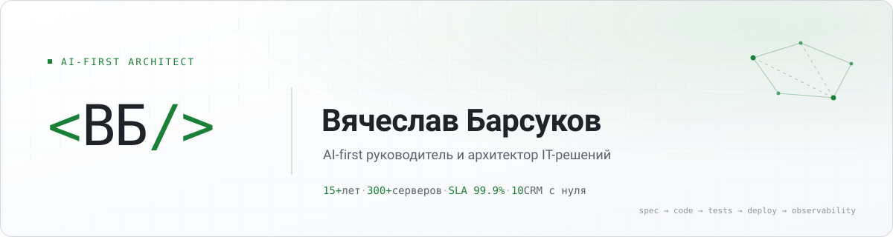

  <picture>
    <source media="(prefers-color-scheme: dark)" srcset="assets/banner-dark.svg">
    <source media="(prefers-color-scheme: light)" srcset="assets/banner-light.svg">
    
  </picture>

  <a href="https://slavabars.ru">slavabars.ru</a> ·
  <a href="https://career.habr.com/slavabars">Хабр Карьера</a> ·
  <a href="https://habr.com/ru/users/slavabars/">Хабр</a> ·
  <a href="mailto:i@slavabars.ru">i@slavabars.ru</a>

> Строю AI-augmented SDLC: от спецификации и генерации кода до продакшена и observability.
> Руковожу командой — и продолжаю писать код. Доказательства ниже.

## Коротко

- **15+ лет** в IT: от низкоуровневой разработки и инфраструктуры до управления IT-подразделением.
- **300+** спроектированных серверов и инфраструктурных сервисов; **SLA 99.9%** на критичной банковской системе.
- **10 CRM** с нуля, **−25%** time-to-market как CTO, **−30%** MTTR, **−15%** эксплуатационных расходов.

## Чем занимаюсь

| Направление | Что внутри |
|---|---|
| **AI-first SDLC** | agentic AI, RAG (pgvector, Elasticsearch, FAISS), prompt engineering, SDD, CI/CD с AI-гейтами |
| **Архитектура** | микросервисы, event-driven (Kafka, RabbitMQ), Kubernetes/OpenShift, IaC (Terraform, Ansible) |
| **Руками** | Python, FastAPI, PyTorch, локальные модели (Ollama, vLLM), MCP, observability (Prometheus, Grafana, OpenTelemetry) |

## Избранные проекты

### [decision-cascade](https://github.com/slavabars/decision-cascade) · Python · Apache-2.0

**Проблема:** сильная модель на каждой задаче — дорого и медленно.
**Сделал:** локальный decision engine с каскадом cheap→strong, калибровкой ECE/Brier и interop-протоколом SystemOne.
**Результат:** 24★, 2 форка, пакеты моделей на Hugging Face, честные вероятности вместо «уверенного» текста.

### [soty](https://github.com/slavabars/soty) · Flutter / Dart · Shell

**Проблема:** мессенджер, который доверяет чужому серверу и требует аккаунт.
**Сделал:** E2EE-мессенджер без аккаунтов и центрального сервера: офлайн — mesh (BLE / Wi-Fi Direct), онлайн — p2p, relay для операторов хостов.
**Результат:** клиенты Android и Linux, дистрибутивы в Releases, deploy/ для самостоятельного хостинга.

### [KirToLat](https://github.com/slavabars/KirToLat) · Java · MIT

**Проблема:** текст набран в неправильной раскладке — и его приходится перепечатывать.
**Сделал:** Android-приложение, которое конвертирует кириллицу в латиницу и обратно на лету.
**Результат:** живой продукт в Google Play с 2018 года — восемь лет без переписывания с нуля.

## Калибровка

Я не пишу «эксперт во всём». Вместо этого — заявленная уверенность и основание: так же, как устроен `decision-cascade`, только про меня.

| Заявление | Уверенность | Основание |
|---|---|---|
| Выведу критичную систему на SLA 99.9% | 0.95 | уже сделано в банковском контуре |
| Сокращу time-to-market на 25% | 0.9 | результат на позиции CTO |
| Снижу MTTR на 30% | 0.9 | метрики инцидентов, не оценка на глаз |
| Внедрю AI-гейты в CI за квартал | 0.7 | зависит от зрелости процессов команды |

## Чего не делаю

- Не обещаю сроки до того, как появилась спецификация.
- Не беру проект без доступа к метрикам и продакшену.
- Не называю себя экспертом там, где не писал код.

## Стек

`Python` · `FastAPI` · `PyTorch` · `PostgreSQL` · `Redis` · `Kafka` · `Kubernetes` · `OpenShift` · `Terraform` · `Ansible` · `GitLab CI` · `Jenkins` · `Prometheus` · `Grafana` · `OpenTelemetry`

## Контакты

Открыт к проектам по AI-трансформации, архитектуре и автоматизации.

**Email:** [i@slavabars.ru](mailto:i@slavabars.ru) · **Сайт:** [slavabars.ru](https://slavabars.ru) · **Хабр Карьера:** [career.habr.com/slavabars](https://career.habr.com/slavabars)

<b>English version</b>

 

AI-first engineering leader and solution architect with 15+ years across low-level development, infrastructure and engineering management. I build the full AI-augmented SDLC: specs → generated code → tests → deploy → observability.

- 300+ servers and infrastructure services designed and operated
- 10 CRMs built from scratch
- SLA 99.9% on a mission-critical banking system
- −30% MTTR, −25% time-to-market, −15% opex

**Selected work:** [decision-cascade](https://github.com/slavabars/decision-cascade) — local calibrated decision engine; [soty](https://github.com/slavabars/soty) — E2EE mesh/p2p messenger with no accounts and no central server; [KirToLat](https://github.com/slavabars/KirToLat) — Android keyboard-layout fixer, on Google Play since 2018.

Open to AI transformation, architecture and automation projects. **[i@slavabars.ru](mailto:i@slavabars.ru)**

<code>Ghbdtn →</code>

 

Эта строка набрана в неправильной раскладке — как половина сообщений в любом мессенджере.
Я написал приложение, которое это исправляет: [KirToLat](https://github.com/slavabars/KirToLat).

`Ghbdtn` → `Привет`.

© 2026 Вячеслав Барсуков · профиль обновляется вручную, как и всё остальное

